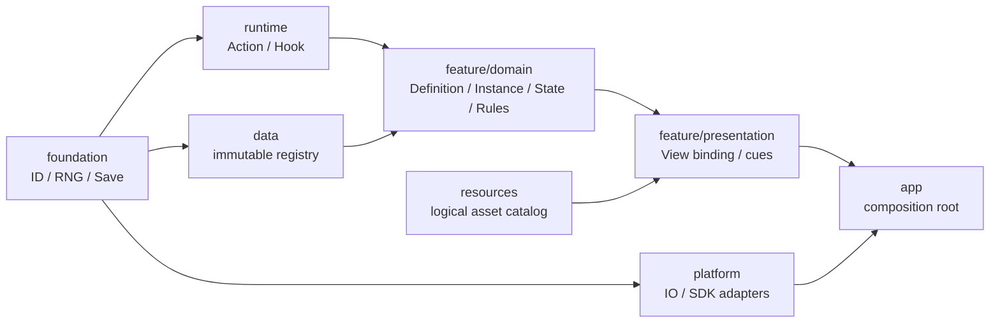
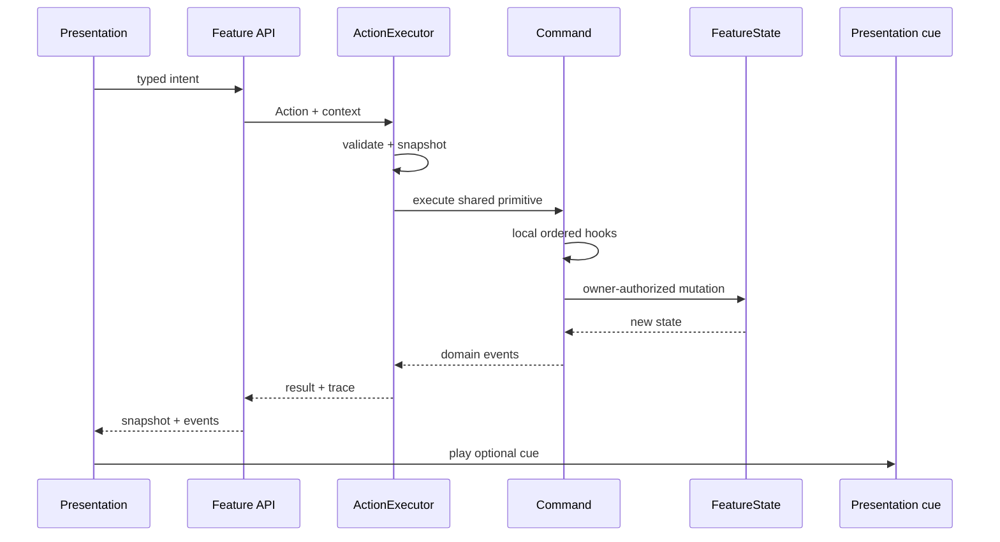

# 技术架构

## 目标与非目标

目标是让普通功能沿稳定边界扩展，同时保留 Godot 的 Scene/Resource 编辑体验。核心不定义卡牌、角色、关卡、经济等玩法对象；这些概念属于具体 Feature。

非目标：完整 ECS、全局事件总线、万能脚本 DSL、预先建设联机回滚、把所有内容强行纯数据化、为只有一个调用者制造抽象。

## 依赖方向

禁止反向依赖。`architecture_lint.py` 自动检查领域 Node 依赖、全局随机、具体 definition-ID 分支、代码动态拼固定 UI、Autoload 和跨层 preload。

## 运行链

`Action` 必须声明失败语义。默认 `atomic`：失败时恢复 Feature 快照；确需分步提交的行为必须显式返回 `stepwise`、记录提交边界和补偿策略。

## 状态所有权

| 状态 | Source of truth | 可写者 | 生命周期 | 持久化 |
|---|---|---|---|---|
| 静态 Definition / tuning | `DataRegistry` | 构建期生成器 | 构建版本 | 生成数据，不进 Save |
| Feature Instance/State | Feature domain | owning Command / Feature API | 功能定义 | Feature save namespace |
| RNG stream/counter | `RngSet` | 使用该命名流的领域机制 | session/save | 是 |
| UI 控件状态 | Scene/View | View | Scene | 否；从领域快照重建 |
| 资源路径/元数据 | `ResourceCatalog` | 资产管线 | 构建版本 | Manifest，不进 Save |
| 平台文件/SDK 状态 | Platform adapter | adapter | 平台/session | 按适配器协议 |

静态 Definition 从注册表返回深复制，调用者不能污染 canonical 数据。场景树、动画和 VFX 不能成为玩法状态的唯一事实源。

## Hook 和事件

- Hook 是 Feature 内局部、命名、排序的规则扩展点，不是全局广播。
- `HookPipeline` 有优先级、注册顺序和同点重入保护；只为已有消费者建立 Hook。
- Domain Event 是已发生的事实，随 ActionResult 返回；UI、音频和 VFX 根据 `presentation_cue_id` 选择表现。
- 不要求所有跨模块消息都经过一个 EventBus。跨 Feature 交互优先由 App/明确协调器提交 Intent。

## 随机与存档

- 玩法随机使用语义命名流；同一 seed 的不同流互不消耗。
- 表现随机另用 `presentation.*` 流，不得改变玩法重放。
- Save 是版本化 DTO，不序列化 SceneTree/Node/Resource。
- 每个 Feature 拥有自己的 save namespace；根 Save 只组合 Feature DTO 与 RNG snapshot。
- 修改 Save schema、RNG 算法/流语义、状态 owner 都需要 ADR 与历史 fixture 测试。

## 何时重新设计

引入联机权威/回滚、大规模实体模拟/ECS、Mod 沙箱、开放世界流式加载、服务器专用构建或跨项目共享二进制模块时，应先做目标架构评审，不在现有边界上堆条件分支。
