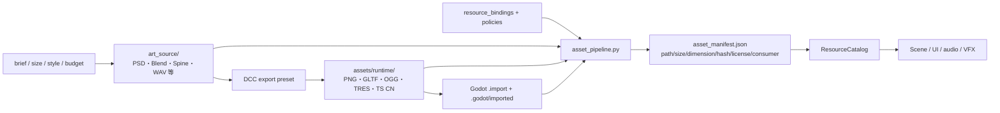

# 美术、动画、音频与 VFX 资源管线

## 目录与事实源

- `art_source/` 是可编辑源，含 `.gdignore`，不被 Godot 导入也不进入发行包。
- `assets/runtime/` 只放 Godot 实际消费的导出资源。
- `resource_bindings.csv` 是 source→runtime→consumer 交接单；`resource_policies.csv` 是格式和预算规则。
- Godot 生成的相邻 `.import` 文件要提交，它保存源工程的导入参数；`.godot/` 只是本地编译缓存，不提交。

## 每个资源必须登记

`logical id`、asset kind、source path、runtime path、policy、budget group、owner、license、required、consumer、尺寸/时长/面数等可测指标、hash、平台变体和验收状态。运行时代码引用逻辑 ID，不把 DCC 路径扩散进玩法代码。

## 分专业最低规范

| 域 | 源交付 | Runtime 交付 | 自动检查 | 人工验收 |
|---|---|---|---|---|
| 2D/UI | PSD/AI/SVG、色彩空间、切图边界 | PNG/WebP/SVG、atlas/TRES | 尺寸、字节、透明边、filter/mipmap/compression policy | 锚点、九宫格、缩放、语言长度 |
| 3D | Blend/Maya、单位/轴向/origin、材质命名 | GLTF/mesh/material | 面数、骨骼、贴图、材质槽、scale、依赖 | 轮廓、LOD、碰撞、平台效果 |
| Animation | rig/source、版本、动画名与 marker 表 | skeleton/AnimationLibrary | skeleton/slot/bone、clip、marker、时长 | 循环、过渡、取消、根运动 |
| Audio | 无损源 WAV、响度与循环点 | OGG/WAV 或自有 bank | 时长、声道、采样率、字节、event/bank 引用 | 响度、混音、并发、语言版本 |
| VFX | brief、flipbook/shader 源、性能档 | TS CN/TRES/shader/texture | 生命周期、粒子峰值、纹理、shader variant、fallback | 读感、遮挡、取消、低配降级 |
| Font/Loc art | 字体授权、字符集、子集脚本 | font/texture bundle | license、glyph coverage、体积、fallback | CJK/RTL/字号/截断 |

当前最小验证器无需第三方库，可读取 PNG/SVG 尺寸、字节、hash、路径、policy、owner、license 和 consumer。项目加入 WebP、GLTF、音频或中间件后，应在同一工具中增加相应 metadata reader 和失败测试，不用人工表格替代门禁。

## 导入与平台策略

- UI/像素资源、世界纹理、法线/HDR、VFX、字体使用不同 policy；不能只按扩展名决定。
- `lossless`、`vram_compressed`、`stream` 等策略映射到经过评审的 Godot import 参数并提交 `.import`。
- 平台降级写在 quality/resource policy，不散落在内容脚本。
- source 与 runtime 可以多对一（atlas/bank）或一对多（平台变体），但 manifest 必须可追到消费者。
- 资源缺失允许可诊断 fallback；required 资源在构建前失败。

## 表现与玩法边界

领域先产生确定结果或 presentation cue。动画、音频和 VFX 可以控制表现时长与取消，但不能绕过状态 owner。表现随机使用独立 RNG 流。涉及规则与表现连接时，按 [测试方案](TESTING_AND_RELEASE.md) 配对领域和真实 Scene/playground 验证；纯素材替换检查对应资源及消费者。

## 交付检查

1. Brief 明确用途、分辨率/单位、风格、平台和预算。
2. Source 放 `art_source/<domain>/`，owner/license 已登记。
3. 按 versioned preset 导出到 `assets/runtime/`。
4. 在 Godot 导入并检查 `.import`；预览场景验收 pivot、布局、动画、音频或 VFX。
5. 运行 `python tools/project.py assets`，再按 [测试方案](TESTING_AND_RELEASE.md) 执行受影响消费者的定向验证。
6. 打包发布时执行完整门禁，并通过发布清单确认 source/editor/test 资产未进入制品。

## Defense 图集更新

界面只保存素材名称，禁止保存图集页路径、AtlasTexture 固定区域或直接访问页数组。头像和补充图标同样登记在 sprites/pages 索引；内部纸框及按钮表面使用管线生成的命名子区域。详见 [ADR-0006](adr/0006-named-defense-atlas-bindings.md)。

更新图集源资源时运行 `python tools/import_defense_reference.py --source <研究资源目录>`，然后使用根目录的 `更新并启动.cmd` 重新生成资料、导入纹理和资产清单。图集重排不需要重建主页场景。没有更新源素材的日常启动继续使用 `启动游戏.cmd`。

按 [测试方案](TESTING_AND_RELEASE.md) 验证受影响图集及消费者，不因单次资源更新默认跑全量。需要验证一次资源重排时运行 `godot --path . --script res://validation/defense/capture_atlas_audit.gd` 和 `python validation/defense/compare_atlas_audit.py`；结果保存在 `validation/defense/atlas_audit/report.json`。该回归覆盖图集位置与尺寸变化，素材名称或内容轮廓改动仍需检查对应美术。
