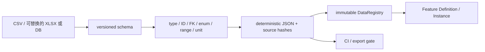

# 策划配置表与数据分类

## 七类数据

| 类别 | 回答的问题 | 当前示例 | 常见负责人 |
|---|---|---|---|
| system_setting | 全局默认值、开关、单位、可否运行时修改 | `system_settings.csv` | 主程/技术策划 |
| definition | “它是什么”的稳定 ID 与编辑器元数据 | `definitions.csv` | 策划/程序 |
| relation | 定义之间的顺序、权重和组合 | `relations.csv` | 策划 |
| tuning | 高频平衡数值、范围、单位 | `tuning.csv` | 策划/数值 |
| localization | 源语言 key 与翻译 | `localization.csv` | 文案/本地化 |
| resource_binding | 逻辑资源 ID 到 runtime 资产与交付证据 | `resource_bindings.csv` | 美术/TA/音频 |
| platform_override | 平台/质量档覆盖，不散落在玩法代码 | `platform_overrides.csv` | 技术/平台 |

`feature_catalog`、`presentation_cues`、`resource_policies` 和 `quality_budgets` 是生产治理表。具体游戏应在 `data/source/<feature>/` 增加自己的定义/关系/调参表，不把所有领域塞进通用 `definitions.csv`。

## 唯一链路

Defense 的中文 XLSX 专用入口已接入：八份表格位于 `data/source/defense_tables/`，刷怪表直接逐行填写确定的怪物 ID，通过 `导表.bat` 或 `project.py data` 编译到 `data/generated/defense_catalog.json`。表格、逐行刷怪、倍率和错误处理见 [配置表说明](CONFIG_TABLES.md)。下述 CSV/schema/DataRegistry 规则继续适用于通用数据目录。



运行时只读 `data/generated/data_catalog.json`，不读 CSV，也不静默转换非法值。生成文件不可手改。

`data/source/` 与 `data/schema/` 含 `.gdignore`，避免 Godot 把策划源表误当运行时 CSV/翻译资源导入；只有 generated JSON 进入 ResourceFS 和发行包。

## 新增一张 Feature 表

1. 在 `data/schema/data_schema.json` 添加 table、class、primary key 和 fields。
2. 源文件放 `data/source/<feature>/table.csv`；schema 的 `source` 可写子目录路径。
3. 每个字段声明 `id/ref/int/float/bool/enum/string/res_path`、required、范围与外键。
4. 必要业务规则添加 `required_child`、`required_when`、`typed_value`、`numeric_range`，或在生成器增加可测试的新约束。
5. 运行 `python tools/project.py data`。
6. 在 `tools/tests/` 至少加入正常、重复 ID、坏引用、坏类型和边界用例。
7. Feature 从 `DataRegistry` 读取 Definition；运行变化进入自己的 Instance/State。

## ID 与变更规则

- ID 使用稳定小写 `a-z0-9_.-`，不使用显示名、数组序号或文件路径作为长期 ID。
- 重命名/删除已进入 Save 的 ID 时必须提供迁移映射；不要静默复用旧 ID。
- 单位必须显式，百分比、秒、像素和计数不可只靠字段名猜测。
- 关系使用独立 relation 表，不在单元格里塞任意代码或难验证的迷你语言。
- 枚举新增值意味着运行时语义变化，需要实现、校验与测试一起提交。

## 错误契约

导表错误必须包含源文件、行、字段、内容 ID、期望类型、实际值和修复建议。当前生成器的错误示例：

```text
[definitions.csv:3:id] table=definitions id=sample.target
expected=unique primary key; actual=...; fix=change the key; first declared on row 2
```

## 本地化

English 是示例源语言，其他语言必须保持 key 集、placeholder、markup 和格式参数一致。大型团队可接 TMS，但仍走“源语言 → 自动同步/MR → placeholder/markup 校验 → 人工审核 → 回传”的单向链。字体和语言特定图片属于资源台账，不直接塞进文本表。
