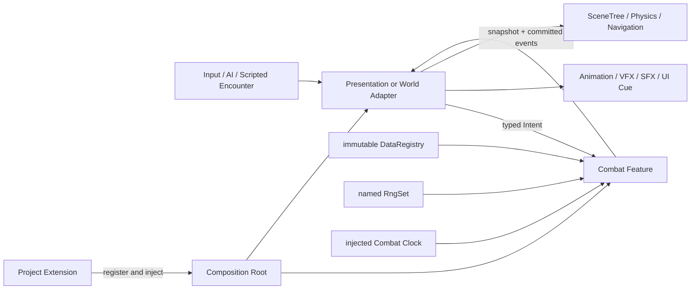
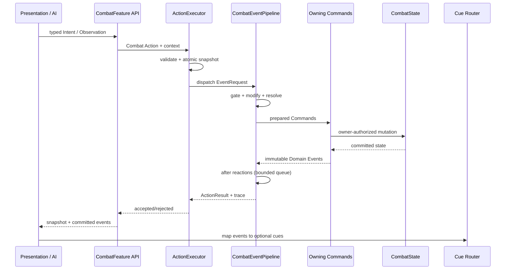
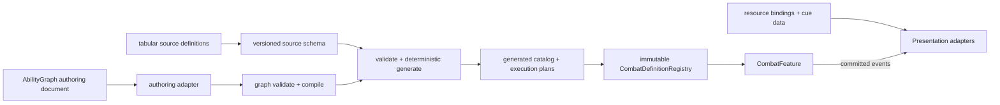

# Combat Framework 总体架构

## 架构结论

Combat Framework 是当前项目中的一个独立 Feature，而不是新的全局运行时。它在领域层拥有 CombatState 和规则执行，复用现有 `ActionExecutor`、`ActionResult`、`DataRegistry`、`RngSet` 与 Save 组合；Presentation 和世界 adapter 通过公开 Intent、Snapshot、Domain Event 与 port 交互。

Core 永远不依赖 Ability、Gameplay Modules、Presentation、Editor 或 Project Extension。Ability 和 Gameplay Modules 只依赖 Core 的公开协议。项目扩展由 App 组合根注入，Combat Framework 不反向加载项目代码。

## 系统上下文



Input、AI、物理命中和脚本事件都先转为 typed Intent 或 TargetObservation。它们不能取得可写 CombatState。Combat 产出的事件只有在 Action 成功提交后才交给表现；表现播放失败不会回滚规则。

## 逻辑分层

```text
Combat Framework
├── Core
│   ├── Entity / Attribute / Tag
│   ├── Effect / Modifier / Formula
│   ├── Event / Trigger / Condition
│   ├── State / Command / Registry / Trace
│   └── Extension API
├── Ability
│   ├── Ability Grant / Run
│   ├── Cost / Cooldown
│   ├── Target
│   ├── Ability Graph Model / Compiler
│   └── Execution Plan / Wait Token
├── Gameplay Modules
│   ├── Damage
│   ├── Buff
│   ├── Projectile
│   ├── Movement
│   ├── Summon
│   └── Area
├── Presentation
│   ├── Cue Router
│   ├── Animation / VFX / SFX
│   └── World and Target Adapters
├── Editor
│   ├── Validation / Pickers / Definition Browser
│   ├── Ability Graph Authoring
│   └── Ability Runtime / Event Trace Debugger
└── Project Extension
    └── project-owned resolvers, policies, adapters and content
```

这是职责图，不要求第一批实现一次创建所有目录或类型。每一层只有在前一层已有可运行纵向路径后才加入。

## 与当前运行链的关系

Combat 不引入第二套顶层事务协议。一次外部请求仍遵循现有链路：



`ActionExecutor` 负责顶层校验、快照、回滚、Action 深度和总 trace。`CombatEventPipeline` 只负责 Combat Feature 内部的规则传播、优先级与 reaction queue。现有通用 `HookPipeline` 继续服务简单的单值局部 hook，不膨胀成 Combat EventBus。

战斗命中采用明确的事实分层：世界或技能先提交 Contact/Observation，`HitModule` 将其解析为 `hit.resolved`/`hit.rejected`，Damage Module 再把一个目标的 `DamageSpec` 提交为 `damage.applied`。Projectile 只负责 Definition/Instance、观测序列和 `projectile.impact`；它不直接扣 Attribute。这样 miss、block、免疫、命中但 0 伤害和真正扣血可以被不同 Trigger/Condition 区分。

Damage request 的提交契约是单目标。多目标 Ability 由 Target/Action 层先按稳定顺序展开为多个独立 Spec；Event Pipeline 内部不把一个 Dictionary relay 当成“同时写入任意数量目标”的隐式批处理。

## 核心聚合与状态所有权

### CombatFeature

`CombatFeature` 是外部唯一领域入口，职责是：

- 接受 typed Intent 与可信的 adapter observation。
- 根据 Definition 创建 Action，并通过 `ActionExecutor` 执行。
- 持有 CombatContext、CombatState、EventPipeline、注册表和 trace。
- 提供只读 snapshot、save DTO、restore 与 Definition fingerprint 校验。
- 在一次 Action 完成后返回 committed Domain Events。

它不继承 Node，不发送全局 Signal，不加载 PackedScene，不解析输入，也不播放 Cue。

### CombatState

`CombatState` 是单个战斗会话的唯一可变聚合，至少拥有：

- session ID、逻辑 tick/turn 和单调 instance sequence。
- Entity instances 及其 Attribute、Tag grant、Effect、Ability grant/run 状态。
- Area/Projectile 等已启用模块的领域状态。
- AbilityRun 的 active execution tokens、wait tokens、scoped variables、reaction queue 和必要的确定性顺序数据。

Command 可以通过窄接口修改自己负责的子状态，但不能绕过 CombatState 直接写别的 Feature。对外 snapshot 是深复制的只读 DTO。

### CombatContext

CombatContext 注入运行依赖：不可变 DataRegistry/CombatDefinitionRegistry、命名 RngSet、EventPipeline、Formula/Condition/Action resolver registry、模块 ports 和 trace sink。它提供 `snapshot_state/restore_state` 以适配现有原子执行协议；快照必须同时覆盖 CombatState、RngSet 和所有已启用模块的事务状态，使失败重试不会改变随机序列或留下模块半状态。

Context 不作为任意对象都能写的 service locator。每种 resolver 只得到其公开接口所需的最小视图。

## Definition、Spec、Instance

所有可能持续或携带执行上下文的概念遵循统一三分法：

| 层级 | 作用 | 可变性 | 例子 |
|---|---|---|---|
| Definition | “它是什么”及静态规则 | 构建期生成，运行时不可变 | EffectDefinition、AbilityDefinition |
| Spec | “这一次如何执行” | Action 内短生命周期 | source、targets、level、captured values、cause chain |
| Instance/Run | “正在持续的那一个” | 由 CombatState 持有 | timed Effect、AbilityRun、ProjectileInstance |

Instant Effect 只有 Definition 和 Spec，提交后产生事实事件，不进入 active instance 容器。持续 Effect、等待中的 Ability 和 Projectile 才创建 Instance。Spec 不进入 Save；未结束的 Instance 以明确 DTO 保存。

## Ability Graph 的四层边界

可视化图是 Ability 的正式 authoring 方式，但它被拆成四个对象，避免 Editor Resource 侵入 Domain：

```mermaid
flowchart LR
  Document["AbilityGraph authoring document"] --> Extract["extract + schema validation"]
  Extract --> Graph["engine-neutral AbilityGraphDefinition"]
  Graph --> Compile["deterministic graph compiler"]
  Compile --> Plan["immutable AbilityExecutionPlanDefinition"]
  Plan --> Run["per-activation AbilityRun"]
  Run --> Snapshot["debug-only AbilityExecutionSnapshot"]
  Snapshot -.-> Editor["GraphEdit runtime overlay"]
```



- **Authoring document** 保存节点、连接、参数、局部变量声明和画布布局。Godot 中优先使用可双击打开的 Resource，但具体文件格式与目录必须先由数据格式 ADR 决定。
- **AbilityGraphDefinition** 是从 authoring document 提取的引擎无关 DTO。连接引用稳定 node ID 与 semantic pin ID，不引用 GraphNode、slot index 或 Control。
- **AbilityExecutionPlanDefinition** 是构建期产物，已解析节点类型、端口、模块依赖、分支、常量和稳定执行顺序。Runtime 只读 plan，不在激活时重新解释编辑器图。
- **AbilityRun** 是本次释放的可变状态，保存活跃 token、wait token、局部 variable frame、cancel scope、cost/cooldown commit 状态和错误；它绝不写回图 Definition。
- **AbilityExecutionSnapshot** 只服务调试，包含稳定 ID 与显示状态；它不进入 Save，也不能反向驱动规则。

Graph Compiler 和 Runtime 位于 Ability Domain，既不依赖 `GraphEdit/GraphNode`，也不加载 EditorPlugin。编辑器可以缺席，CI 仍能从 canonical source 编译 plan 并运行 fixture。

## 时间模型

Core 只认识单调递增的整数逻辑时间：

- 回合制项目在回合、阶段或行动点推进时提交 `AdvanceCombatTimeIntent`。
- 即时项目由一个 Node adapter 把物理帧/固定步长聚合为整数 combat tick，再提交给领域。
- duration、period、cooldown 和 Ability Graph wait 都以定义中声明的时间单位解释；一个 Combat Session 只能有一种基础单位。
- 不允许 Effect/Ability 自己创建 Timer 或读取 `Time`/墙钟。
- 同一 tick 到期的 instance 使用稳定 instance sequence 排序。

改变 tick 单位、推进语义或 Save 中时间表示属于契约变化，需要 ADR。

## 目标与世界交互

Core 不查询 SceneTree、PhysicsServer、NavigationServer 或 Node group。世界相关能力通过 adapter/port 进入：

1. Presentation/World adapter 观察输入、碰撞、区域成员或导航结果。
2. Adapter 生成带 entity ID、几何数据和 observation sequence 的 TargetObservation/Intent。
3. Combat Action 根据当前状态、Tag、关系和项目策略重新验证。
4. Combat 提交结果并发出事实事件。
5. Adapter 根据事实移动 Node、生成投射物表现或播放 Cue。

不需要物理的目标选择（自身、显式实体、队友、效果来源、事件目标）完全在领域内完成。需要物理的查询由 Gameplay Module 定义窄 port，而不是让 Core 获得 World 引用。

## 表现架构

Presentation 读取 Combat snapshot 和 Domain Events。Cue Router 将 `cue_key + parameters` 映射到逻辑资源 ID、PackedScene、Animation、AudioStream 或 UI handler。

Cue 支持 `executed`、`started`、`updated`、`ended`、`cancelled` 等表现生命周期，但这些状态来自已提交领域事件。持续 VFX 的 handle 由 Presentation 自己持有；领域只保留 effect instance ID，二者通过映射关联。丢失或重复 Cue 必须可幂等处理。

## 数据流与唯一事实源



表格型 Definition 继续使用当前 `data/source → schema → generated JSON` 链路。图拓扑不强塞进 CSV relation rows；ADR-0001 已确定 `authoring/combat/ability_graphs/` 下的 Godot-native `AbilityGraphResource` 为 canonical authoring 载体。Resource 不与 CSV 双写同一图语义，Runtime 只消费 engine-neutral execution plan。

无论 authoring 格式最终为何，生成 catalog 中的不可变 execution plan 才是 Runtime 输入。当前 `python tools/project.py graphs` 扫描 Resource、调用同一 `AbilityGraphCompiler` 并写出 `data/generated/ability_plans.json`；Runtime 通过 `AbilityPlanCatalog` 读取它。画布位置、折叠、颜色和注释不进入 gameplay fingerprint；节点类型、参数、连接、变量 schema 和 entry points 必须进入 fingerprint。

## 组合根

App Composition Root 按以下顺序装配：

1. 加载并校验 DataRegistry、ResourceCatalog 和 Definition fingerprint。
2. 创建 RngSet、CombatState 与 EventPipeline。
3. 注册 Core 内建 Condition/Formula/Action resolver，以及 Ability node descriptor/compiler/executor。
4. 注册项目启用的 Gameplay Modules，并验证 capability/requirement。
5. 注册 Project Extension；重复 type ID、缺依赖或顺序冲突直接启动失败。
6. 创建 CombatFeature。
7. 创建并注入 Node/Presentation adapter，连接局部 Signal。

不使用 Autoload，不从 Core 扫描脚本目录或按类名反射发现扩展。注册清单是显式、可测试、顺序确定的。

## 故障与原子性

- 默认 Combat Action 是 atomic；EventPipeline 内生成的所有 Command 和 reaction 都属于同一事务。
- 只有确有持续外部副作用的流程才允许 stepwise，并必须声明 commit point、补偿和可恢复状态。
- Adapter 外部操作永远发生在领域提交之后，因此不包含在领域回滚中；它们必须可重建或幂等。
- 未知 Definition、缺 Entity、非法 target、Condition false、资源不足、cooldown、事件预算耗尽和扩展错误都有稳定 error code。
- 扩展抛错或返回非法结果视为 Action 失败；不静默跳过并继续形成半提交状态。

## 预期物理目录

实现阶段从最小目录开始，目标边界如下：

```text
src/runtime/core/                # Entity / Attribute / Tag / Effect / Event / Condition / Formula
src/runtime/ability/             # graph definitions / compiler / plan / grant / run
src/runtime/modules/             # optional Damage / Buff modules

src/features/<project_feature>/
├── domain/ability_extension/    # 仅消费项目拥有；库代码不得导入
└── presentation/
    ├── adapters/
    └── cues/

addons/combat_framework_editor/ # 可选 editor-only 插件
data/source/combat/              # 现有人工编辑表格源数据
authoring/combat/ability_graphs/  # canonical Resource source; excluded from release
data/generated/                  # 生成物，禁止手改
tests/combat/                    # 纯领域、管线与场景集成测试
```

`project_extension/` 是消费项目的注入端，不是公共库的一部分。若未来以独立 addon/GDExtension 分发 Combat Framework，需要单独 ADR 决定包边界、版本、语言和生成数据接口，不在第一阶段预设。

## 架构演进门槛

以下变化不能作为普通功能顺手加入：

- 网络权威、客户端预测、rollback/reconciliation。
- ECS 或大规模批处理 Entity 存储。
- 新 Autoload、全局 EventBus 或动态脚本发现。
- Combat Definition 新文件格式、AbilityGraph Resource 成为 canonical source、通用运行时脚本 DSL，或执行未编译 editor graph。
- 跨 Combat Session 的持续 Effect/Ability 或跨 Feature 直接状态写入。
- RNG 算法/流语义、CombatClock、Save DTO、handler 排序或 commit point 变化。

这些变化都需要真实需求、ADR、迁移/回放 fixture 和完整检查，不通过兼容层或临时双轨实现。
