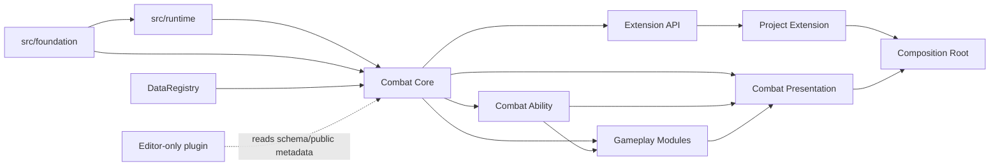

# 模块边界与依赖规则

## 总规则

模块边界以“谁拥有状态、谁允许知道谁”为准，不以文件数量为准。Core 提供最小稳定协议；Ability 和 Gameplay Module 使用协议；Presentation/Editor/Project Extension 位于外侧。任何外层模块都可以依赖内层公开接口，内层不得 preload、查询或按 ID 识别外层实现。

图中的 `Ability --> Modules` 只表示需要 Ability Graph 集成的模块可以依赖 Ability 的公开扩展协议。模块提供 NodeDescriptor、ActionDefinition/Resolver 和可选 executor；Ability Compiler/Runtime 只认公开协议，绝不导入 Damage/Projectile 等模块类型。

## 模块职责表

| 模块 | 拥有 | 可以依赖 | 禁止 |
|---|---|---|---|
| `foundation` | ID/RNG/Save 等底层协议 | 无上层模块 | Combat、Node、项目内容 |
| `runtime` | Action/Result/Hook 执行契约 | foundation | Node、Combat 概念、Feature |
| Combat Core | CombatState、Entity、Attribute、Tag、Effect、Event Pipeline、Condition/Formula 协议 | foundation、runtime、DataRegistry 抽象 | Ability、具体 Gameplay Module、Node、Resource 路径、项目 Extension |
| Ability | grant/run、cost、cooldown、target、graph model/compiler、execution plan | Core | GraphEdit、SceneTree、具体伤害/移动规则、项目内容 ID |
| Gameplay Module | 某一可选领域能力及其 Action/Resolver/State | Core；必要时 Ability 的公开扩展协议 | 修改 Core 私有状态、依赖 Presentation、按项目 ID 分支 |
| Presentation | Node adapter、snapshot/view model、Cue 路由和播放 | Combat 公开 snapshot/event、ResourceCatalog | 写 CombatState、决定规则结果 |
| Editor | schema UI、Ability Graph 画布、ID 选择器、编译诊断、preview、runtime/trace 工具 | authoring adapter、schema、生成器、只读公共元数据 | 被运行时 preload；直接执行 GraphNode；成为 canonical runtime state |
| Project Extension | 项目专属 evaluator/resolver/policy/adapter | Extension API、已启用模块的公开接口 | 被 Core/共享模块反向依赖；直接写其他 Feature 状态 |
| App | 生命周期和依赖装配 | 所有需要组合的公开入口 | 放业务规则或内容 ID 分支 |

## Combat Core 内部边界

Core 本身按职责拆分，但第一版不为每个名词制造抽象层。

### Entity

- 拥有 CombatEntity 的稳定 instance ID、definition ID、生命周期状态和子状态容器。
- 提供按 ID 的只读查询和由 Command 使用的窄 mutation API。
- 不知道对应哪个 Node，也不保存 NodePath/ObjectID。

### Attribute

- 拥有 attribute base value、约束和 active modifier 索引。
- 负责确定性聚合、clamp 和变更事实。
- 不定义 health、mana、armor 等内容语义；这些只是项目 Definition ID。

### Tag

- 拥有层级 tag registry、query evaluator 和 source-token 计数。
- 负责 grant/revoke 的来源隔离。
- 不承担任意键值存储；需要数值的概念使用 Attribute/State。

### Effect

- 拥有 Definition/Spec/Instance 生命周期、持续时间、周期、叠层和其产生的 grant handles。
- 通过 Modifier、Trigger 和 Command 组合影响状态。
- 不把 Damage、Projectile、Movement 等模块语义写进通用 Effect manager。

### Event / Trigger

- Event Pipeline 拥有 handler discovery、冻结、排序、阶段、reaction queue、预算和 trace。
- Trigger 描述事件匹配、Condition 和 reaction，不直接持有外部对象回调。
- 它不是跨 Feature 或跨 Session 的消息总线。

### Condition / Formula

- 定义纯求值协议、内建少量 evaluator 与注册表。
- evaluator 接受只读 EvaluationContext，不取得可写 CombatState/RngSet/SceneTree。
- 新 evaluator 只能由 Module 或 Project Extension 显式注册。

## Ability 边界

Ability 负责“何时可以开始、开始后如何推进、何时提交成本/冷却、如何结束或取消”，不负责每种动作的业务语义。

| 子模块 | 负责 | 不负责 |
|---|---|---|
| Ability | definition、grant、activation policy、concurrency/cancel、run lifecycle | 具体伤害/移动/召唤算法 |
| Cost | 预检一组 payment，生成原子 Commands，声明 commit/refund policy | 直接改 Attribute、物品或其他 Feature |
| Cooldown | 定义开始时机、组和持续时间；默认生成 cooldown Effect/tag | 创建 Node Timer |
| Target | 显式实体/关系/事件目标选择和 TargetObservation 校验 | 查询 SceneTree/PhysicsServer |
| Graph Model | 稳定 node/pin ID、typed connections、entry points、scoped variables、subgraph contract | Godot Control、运行实例状态 |
| Graph Compiler | 节点/端口/能力校验，生成确定性 ExecutionPlan | 运行时读取 GraphEdit 或动态扫描节点脚本 |
| Graph Runtime | 执行 plan、active/wait token、branch/join、cancel scope、end cleanup | 任意脚本执行、每帧扫描所有节点、表现决定规则时机 |

具体 Action node 只引用稳定 node/action type 和经过校验的参数。Damage Module 注册 `damage.deal` descriptor/compiler/resolver，Movement Module 注册 `movement.move`；Ability Compiler/Runtime 只调用统一接口。Editor 由同一 descriptor 生成目录和 pin，不维护第二张节点表。

## Gameplay Module 约束

每个模块必须是可选的，并提供以下最小 manifest：

- 稳定 `module_id` 与版本。
- `provides` capability 集。
- `requires` 与可选 `after` capability 集。
- 注册的 action/condition/formula/target/event 与 Ability node type ID。
- 拥有的 State/Save DTO。
- 使用的 RNG stream 命名规范。
- 公开 Domain Event 与错误码。
- 测试 fixture 和卸载/清理语义。

组合根在启动时拓扑排序并拒绝缺失依赖、循环、重复 type ID 或不兼容版本。模块不自行扫描目录或注册全局 singleton。

### 首批模块定位

| 模块 | 最小职责 | 典型端口 |
|---|---|---|
| Damage | damage request、免疫/修正/吸收、生命类 Attribute 提交、伤害事实 | 无强制世界端口 |
| Buff | 正/负分类、dispel category、cleanse/dispel Action、常用持续 Effect authoring 约束 | 无 |
| Projectile | 领域 projectile 生命周期、命中 observation 校验、命中 Action | ProjectileWorldPort |
| Movement | move/knockback/teleport 请求、规则约束与已提交移动事实 | MovementWorldPort |
| Summon | spawn request、owner/lifetime、entity registration | EntityFactoryPort |
| Area | area instance、成员 observation、enter/exit/stay Action | AreaObservationPort |

Buff 不重复实现 Core Effect；它只增加跨项目稳定的“状态效果分类和驱散”语义。Projectile/Movement/Area 不把 Godot 2D/3D 类放进 Domain，它们的 2D/3D 差异留在 port adapter。

### 命中与伤害的内部边界

Damage Module 内部仍拆成三个可替换职责：

1. `Contact/Observation`：接收带 entity ID、observation sequence 和当前 logical tick 的世界事实。
2. `HitModule`：根据命中规则产生 `hit.resolved` 或 `hit.rejected`，只描述命中结果，不修改生命值。
3. `DamageCommitHandler`：只接受单目标 `DamageSpec`，执行组件汇总、免疫/修正后的提交，并产生 `damage.applied` 与可选 `entity.defeated`。

Projectile 的 `impact()` 只进入第 1 步；它不调用 Damage，也不持有 Attribute 引用。Ability/Project Extension 可以把 `projectile.impact → hit.resolved → DamageSpec` 组合成规则，而无需修改 Projectile Core。

## Port 规则

Port 是领域与 Godot/项目世界之间的窄接口，只在出现真实外部操作时建立。

### 输入型 port

输入型 port adapter 把世界事实转为 observation，例如碰撞命中、区域成员或导航可达性。领域必须再次校验 entity 存在、sequence、关系、Tag 和能力状态。未经验证的 Node 引用不能进入 EventContext。

### 输出型 port

输出型 port 只消费已提交事实，例如移动 Node、生成表现 projectile 或创建 summon scene。调用失败产生诊断事件/日志，不反向篡改已提交 Domain Event。若外部操作本身决定规则，必须改为“两步 observation → domain commit”，而不是先做副作用再通知领域。

### Port 数据限制

- 使用稳定 entity ID、logical resource ID 和可序列化 value object。
- 不跨边界传 Node、Callable、Signal、Resource 的可写实例或 SceneTree。
- 2D/3D 向量只在相应模块的 value type/adapter 中出现，不污染无空间概念的 Core。
- Port 不允许扩展任意 Dictionary；新增字段需要类型、版本和测试。

## Presentation 边界

Presentation 可以：

- 将输入、AI 选择或世界观察转成 Intent。
- 读取 snapshot 构造 ViewModel。
- 将 committed event 映射到 Cue。
- 持有 Node、AnimationPlayer、AudioStreamPlayer、GPUParticles、Tween、PackedScene 和表现随机流。
- 使用局部 Signal 将已发生的 UI/世界事件交给父级协调器。

Presentation 不可以：

- 直接设置 Attribute、Tag、Effect、AbilityRun 或逻辑时间。
- 根据动画是否播完决定 damage 是否发生。
- 把 Node 的存活、position、visibility 或 animation state 当作唯一玩法事实。
- 订阅一个全局 Combat Signal 并依赖连接顺序实现优先级。

## Editor 边界

EditorPlugin 放在 `addons/combat_framework_editor/`，只能依赖 schema、source data、生成器和公开只读 metadata。Runtime 不得 preload Editor 脚本。关闭插件、命令行导出或 headless check 时，数据校验和生成结果必须相同。

表格型 Definition 仍来自 `data/source/combat/`。Ability Graph 拓扑由已接受的 ADR-0001 固定为 `authoring/combat/ability_graphs/` Resource source，不与 timeline relation 双写。Runtime 只加载生成后的 engine-neutral plan；禁用插件不会改变编译和执行结果。

## Project Extension 边界

Project Extension 只通过 `extension_api` 注册：

- 新的 Condition/Formula/Action/Target evaluator。
- 新的 Event handler provider 或 stacking/cost policy。
- 项目专属 Gameplay Module。
- World port adapter 与 Cue resolver。

Extension 可以依赖 Core 和明确启用的模块，不能访问 Core 私有字段。它的代码由消费项目拥有，可物理放在 `src/features/<project_feature>/domain/ability_extension/`；公共 Combat 库不得 preload 该目录。Composition Root 显式创建并注册扩展实例。

项目其他 Feature 若要参与 Combat，默认由 App/明确协调器在各自公开 Intent/Event 间转换，不直接写 CombatState。确需跨 Feature 依赖时，先按项目规则提交 ADR。

## 依赖评审清单

新增文件或模块前必须确认：

1. 状态 owner 是否唯一，Save namespace 是否明确？
2. 内层是否出现对外层类型、ID、资源路径或 Node 的引用？
3. 能否用已有 Action/Command/port 完成而不新增全局服务？
4. 模块关闭后 Core/Ability 是否仍可加载并通过测试？
5. 注册顺序是否显式且确定，是否有缺依赖/重复 ID 测试？
6. 是否把表现反馈误建成规则输入？
7. 是否新增数据格式、RNG/Save/时钟/跨 Feature 契约而需要 ADR？

任何一项无法回答时，模块边界尚未完成，不能用 service locator、Callable 字段或 Dictionary 逃避设计。
