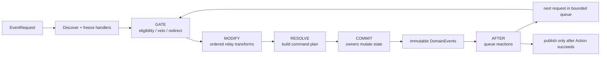

# Combat Event Pipeline

## 目的

Combat Event Pipeline 用于解决多个 Ability、Effect、Tag、模块和项目规则同时影响一次战斗请求时的传播、修正、拦截和后续反应。它借鉴有序 relay 的思想，但严格落在当前项目的 Action/Command 原子事务内。

它不是通知总线。它必须回答：谁有资格处理、按什么顺序、能改什么、何时提交、失败如何回滚、后续事件如何防止无限递归。

## 三类对象

| 对象 | 含义 | 可变性 | 是否对外发布 |
|---|---|---|---|
| `EventRequest` | 某件事“准备发生”的请求，例如尝试造成伤害或应用 Effect | 创建后只读 | 否 |
| `EventContext` | 管线内部工作上下文，包含 relay、阶段、handler snapshot、cause chain 和 trace | 仅管线按阶段受控修改 | 否 |
| `DomainEvent` | Command 已经提交的事实，例如 damage applied、effect removed | 不可变 | Action 成功后发布 |

“requested”不是“happened”。Presentation 只能消费 DomainEvent，不能把 EventRequest 当成已经发生的结果。

对战斗语义，至少保留以下事实边界：`projectile.impact`（接触/命中观测）、`hit.resolved` 或 `hit.rejected`（规则命中判定）、`damage.applied`（实际属性提交）和 `entity.defeated`（生命周期事实）。它们可以通过 Trigger 串联，但不能由一个“命中”回调同时代表全部四层。

## 标准阶段

### 1. Discover

管线按 event type 从索引中收集相关 handler：

- request/cause 自带的 definition handler。
- source Entity 上的 base component、active Effect、granted passive Ability handler。
- target Entity 上的相同来源；多目标按稳定 entity sequence 展开。
- 当前 Combat Session/module/project policy handler。

只收集声明匹配该 event type、scope 和 phase 的 handler。收集完成后冻结列表；当前分发中新增/删除 Effect、Tag、Ability 或 Trigger 不改变本次分发尝试的列表，从下一事件开始生效。

### 2. GATE

GATE 只做资格判断和允许的目标重定向：

- Condition false 通常表示 handler 不参与，不等于整个请求失败。
- Gate handler 可以返回 `REJECT(error_code)` 阻止请求。
- redirect 必须产生新的不可变 EventRequest，记录原目标并立即终止本次分发尝试；管线对新目标重新 Discover 和冻结 handler。每组已访问目标只允许出现一次，redirect 计入 depth/budget，循环或超限稳定失败。不能直接改 Node。
- GATE 不消费 RNG、不写状态、不排 Cue。

Core 不变量（ID 存在、状态 owner、非法数值、事件预算）在 handler 之外先检查，不能被高优先级扩展绕过。

### 3. MODIFY

MODIFY 按顺序转换 relay，例如 damage magnitude、duration、target count 或 cost amount：

- Modifier 读取只读 EvaluationContext，返回 `CONTINUE` 或 `REPLACE(new_relay)`。
- 每个中间值按 event contract 做类型、有限值、范围和单位校验。
- Formula 不能隐式消费 RNG。需要概率时，由显式 Roll Action 使用命名流并把结果放入 Spec/Context。
- MODIFY 不写 Attribute、消耗护盾、添加 Effect 或发出事实事件。

### 4. RESOLVE

唯一 resolver 根据最终 relay 和当前只读状态创建 Command plan。它可以计算需要写入的多个 owner 子状态，但仍不立刻提交。

例如 Damage resolver 可以准备“消耗 shield attribute 30 + 扣 health attribute 60 + 记录 absorbed 30”的组合 Command；Effect resolver 可以准备 stacking、tag grants、modifier attach 和到期队列变化。Damage request 在本层只允许一个 target entity；多目标在 Action 层展开成多个有独立 cause/spec 的 request。计划中每个写入都标明 owner、前置条件和失败语义。

### 5. COMMIT

Command 按稳定顺序通过状态 owner 的公开 mutation API 提交，并生成不可变 DomainEvent。任一 Command 失败会使顶层 atomic Action 恢复 CombatState 与 RNG snapshot；尚未发布的事件全部丢弃。

COMMIT 不是可插拔任意回调阶段。扩展只能提供经过注册的 Command/Resolver，实现必须遵守 owner 和事件契约。

### 6. AFTER

AFTER handler 只能观察已提交事实并排队新的 EventRequest/Action：

- 反伤根据 `damage.applied` 的实际 damage 创建新 damage request。
- 击杀触发根据 `entity.defeated` 排队 Effect/Ability reaction。
- 连锁效果根据 cause chain、Tag 和目标条件排队下一目标。

AFTER 不能修改过去的 DomainEvent，也不能撤销已发生的 damage。若 reaction 后续失败且属于同一 atomic Action，整个 Action 仍回滚；若业务需要“主效果成功、附加反应可失败”，必须把 reaction 声明为新的事务或显式 stepwise commit boundary。

## 与 Ability Graph 的连接

Ability Graph 不绕过 Event Pipeline：

- `OnCast` 由 Ability activation Action 创建首个 execution token，不是 Godot Signal。
- `OnHit`、`OnKill`、`OnExpire` 与 `WaitEvent` 编译为有类型的 committed event subscription descriptor，并由 wait-token index 按 event type/scope 定位。
- 匹配的 DomainEvent 只会 enqueue graph resume/reaction；真正的下游 Action 仍重新进入标准 EventRequest 管线。
- Event entry 默认只能观察 AFTER fact。需要 GATE/MODIFY 的被动规则应注册明确的 Trigger/Modifier handler，不允许借图节点事后改写 relay。
- subscription 属于 AbilityRun/cancel scope，run end、cancel、grant revoke 或 owned scope exit 时按 handle 精确注销。
- 同一 event 唤醒多个 Run 时按 subscription registration sequence、run sequence、node ID 稳定排序，并计入顶层 reaction budget。

这样 Graph Editor 中的事件节点只是领域订阅的可视化 authoring，不会形成第二个 Signal/EventBus 或隐藏优先级系统。

当前实现通过 `CoreEventPipeline.register_committed_observer()` 提供 session-local 的已提交事实观察句柄；`AbilityService.attach_pipeline()` 使用该句柄驱动事件入口，销毁时必须 `detach_pipeline()`。这不是全局 EventBus，observer 也受 pipeline 的 observer depth budget 约束。`CoreEventPipeline.trace()` 返回有界的 request → handler → DomainEvent trace，供 Debugger/Replay adapter 读取。

## Handler 结果

Handler 不使用 `null`、真假值或异常表达普通控制流。逻辑结果只有：

| 结果 | 允许阶段 | 语义 |
|---|---|---|
| `CONTINUE` | GATE/MODIFY/AFTER | 不改变 relay，继续 |
| `REPLACE(value)` | GATE 的 target redirect、MODIFY | 替换声明允许的 relay 字段 |
| `REJECT(error_code)` | GATE/MODIFY/RESOLVE 前置检查 | 请求失败；是否回滚由 Action atomicity 决定 |
| `ENQUEUE(requests)` | AFTER | 把新请求追加到 reaction queue |

非法结果、错误类型、NaN/Infinity、未注册 request type 或 handler 异常都转成稳定 framework error，并让 Action 失败。

## 确定性排序

同一阶段的 handler 使用完整排序键，禁止依赖 Dictionary、SceneTree、Signal 连接或文件系统枚举顺序：

1. `priority`：高值先执行。
2. `scope_rank`：request/cause、source、target、session，按固定次序。
3. `owner_sequence`：Entity/Effect/Ability 的单调 instance sequence，低值先执行。
4. `registration_sequence`：静态注册由确定性数据加载顺序产生；动态注册使用所属 instance sequence，低值先执行。
5. `handler_id`：稳定 ID 最终兜底，字典序升序。

多目标先按 Entity instance sequence 排序，再展开每个目标 handler。语义上依赖先后的规则必须明确设置 priority，不能依靠 scope/tie-break 的偶然顺序。

公共 priority 范围为 `-1000..1000`，默认 `0`；建议使用 `500`（early）、`0`（normal）、`-500`（late）等稀疏档位，为项目插入规则留空间。Core 安全校验不占 priority，也不能被覆盖。越界值在数据生成阶段失败。

## Handler 生命周期与索引

Handler 可能来自静态 Entity Definition、active Effect、passive Ability、Area 或 Project policy。每个动态来源注册时获得 handle，来源结束时按 handle 精确注销。

- 同一 Effect refresh 不重复注册 handler。
- 独立 Effect instance 各有自己的 owner sequence。
- 注销不存在的 handle 是错误，不静默忽略生命周期泄漏。
- event type → scope → handler handles 建索引，避免每次扫描全部 Entity/Effect。
- handler 条件求值仍以分发时 snapshot 为准，不能缓存跨事件真假值。

## Reaction queue 与循环保护

后续反应使用 FIFO 队列迭代处理，不直接递归调用 EventPipeline。每个 request 记录：

- root action ID 与 transaction ID。
- parent event ID、depth 和 cause chain。
- source/instigator/targets。
- originating definition/instance/handler ID。
- 已使用的 gameplay RNG stream 与 roll sequence（若有）。

保护规则：

- 深度不得超过现有 `ActionExecutor` 的 action depth 契约；Combat reaction 另计 event depth，但默认同样以 16 为上限。
- 每个顶层 Action 有总 request/event budget；预算是 system setting 并进入 replay fingerprint。
- 同一 handler 在同一 event 上只执行一次。
- 项目内容必须用 cause tag/Condition 阻止无意义自反，例如 reflect 产生的 damage 默认携带 `cause.reflected`，反伤 Trigger 可排除它。
- 达到深度或预算不是“跳过剩余事件”，而是稳定失败并回滚 atomic Action，避免产生隐蔽的半结果。

具体总预算值在实现纵向切片的性能测试后写入 `system_settings`，不在设计阶段猜测。

## RNG 规则

- handler 排序本身不使用随机数。
- chance-to-apply、命中、暴击等是显式 Roll Action/Resolver，由模块定义语义命名流，例如 `combat.hit`、`combat.critical`；具体命名在模块契约中登记。
- 一个 roll 的消费位置在 event contract 中固定，Condition false 或早期拒绝时是否消费必须有明确规则并用 fixture 锁定。
- Formula/Condition/Presentation 不得消费 gameplay 流。
- atomic Action 失败时恢复 RngSet snapshot，保证重试不会漂移。

## Capture 语义

EventRequest/EffectSpec 必须声明数值读取时机：

- `live`：每次求值读取当前 snapshot。
- `on_request`：创建 EventRequest 时捕获。
- `on_apply`：Effect 成功应用时捕获，供整个 instance 使用。
- `on_activation`：AbilityRun 创建时捕获。

不允许 evaluator 自行决定缓存。Capture 值作为 Spec/Instance 的有类型字段进入 trace；需要跨 Save 的值存入 instance DTO。

## 示例：伤害、护盾与反伤

一次攻击产生 damage request，流程如下：

1. GATE：目标的免疫 Condition 可以拒绝；source/target 存活和关系由模块不变量验证。
2. MODIFY：source 增伤 Modifier 将候选值从 100 改为 120；target 减伤将其改为 90。
3. RESOLVE：读取目标 shield=30、health=80，准备 shield -30、health -60 的组合 Command。
4. COMMIT：提交两个 Attribute 变化，产生 `shield.absorbed(30)` 与 `damage.applied(actual=60)`；若 health 到 0，再产生 `entity.defeated`。
5. AFTER：反伤 Trigger 读取 actual=60，按 Formula 创建带 `cause.reflected` 的新 damage request 并入队。
6. 反伤 request 重走完整管线；原反伤 Trigger 的 Condition 排除 `cause.reflected`，不会无限反射。
7. 所有 reaction 成功后，事件缓冲随 ActionResult 返回，Presentation 才播放命中、护盾和死亡 Cue。

这里护盾消耗发生在 RESOLVE/COMMIT，而不是 MODIFY，因为它是有状态写入；减伤 Modifier 才是纯 relay 转换。

## 同一 tick 的到期与周期事件

逻辑时间推进也是一个 atomic Action。同一 tick 内按以下顺序生成 request：

1. 根据 `(due_tick, instance_sequence, definition_id)` 排序到期/周期项目。
2. 先处理该 tick 已计划的 periodic execution，再处理 expiration；EffectDefinition 可以显式选择“到期 tick 是否执行最后一次”，默认值必须在 schema 中可见。
3. 每个 execution/expiration 都进入 reaction queue，使用普通事件阶段。
4. 分发中新增且 due_tick 等于当前 tick 的 instance 不插队；进入下一轮 queue，并受总预算限制。

项目不得依赖 SceneTree `_process` 顺序决定持续效果结果。

## Trace 契约

开发构建中的每个顶层 Action trace 至少包含：

- transaction/action/request/event/parent ID。
- phase、handler ID、来源 instance、priority 和完整排序键。
- Condition 结果与稳定失败码。
- relay 修改前后值；敏感/大型载荷使用摘要。
- Formula ID、capture policy 和输入来源。
- Command plan、实际提交值和 DomainEvent ID。
- RNG stream、roll sequence 和结果；不记录无法安全输出的外部数据。
- depth、累计预算和回滚结果。

Trace 有容量上限，不进入正式 Save，也不能反向参与规则。Editor Debugger 只读取 trace DTO。

`CoreEventTraceComparison.compare()` 只比较跨版本可复现的语义字段（request payload、事件来源/目标、事实 payload、handler trace、逻辑 tick 和错误码），忽略运行期间自动分配的 event ID；结果返回首个差异的 entry/field，供 replay fixture 和调试器定位漂移。

## Event Pipeline 与 Godot Signal

Godot Signal 适合 Presentation/Node 对“已发生事情”的低耦合响应，但不提供本管线需要的 relay、显式拒绝、稳定优先级、handler snapshot、事务回滚和 cause chain。因此：

- Combat rule handler 不实现为 Signal subscriber。
- Action 成功后，Presentation adapter 可以用局部 Signal 转发 committed events。
- Signal callback 不允许提交嵌套状态写入；需要反应时，它创建下一次 typed Intent。
- 不建立全局 `CombatEvents` Autoload。
