# Combat Framework 编辑器架构

## 架构结论

Combat Framework 有正式的可视化技能编辑器。目标形态是 Godot EditorPlugin 内的领域专用 Ability Graph Editor，以 `GraphEdit + GraphNode` 为画布底座，参考 Forge Statescript 的 graph/processor 分层、Orchestrator 的节点编辑基础设施、LimboAI 的运行时调试协议。

它不是 Orchestrator 的替代品，也不是通用 Visual Script：只能编排注册过的 Combat Event、Target、Action、Logic、Data 与 Presentation Cue 节点。Editor、Compiler 与 Runtime 共用同一节点 descriptor 和 schema，但承担不同职责。

## 参考系如何落地

| 参考 | 采用 | 不采用 |
|---|---|---|
| Forge Statescript | Graph Resource/Document、definition 与 per-run processor 分离、节点发现与专用 node editor 分层、owned subgraph 生命周期 | Autoload/global bus、反射扫描、共享变量袋、每帧 tick 所有 state node |
| Godot Orchestrator | Action catalog、上下文搜索、typed pin、Pin Widget Factory、model-first clipboard、UI graph 与 runtime 分离 | 通用脚本语言、自定义 runtime/compiler、宽松 Variant coercion、直接作为项目依赖 |
| LimboAI | 活跃实例列表、选择后按需订阅、轻量 execution snapshot、状态/耗时增量更新 | Behavior Tree 的 Success/Failure/tick 语义、任意 Blackboard 共享状态 |
| GraphEdit / GraphNode | 画布、port、连线交互、框选、缩放、minimap、connection activity | 把 Signal 请求误当数据模型、把 slot index 当长期 pin ID |
| SkillEditor | 内容树、依赖展示、易用性 | 把解锁技能树当 Ability 行为图 |

完整源码结论与链接见[参考系统分析](01_reference_analysis.md)。

## 四个不能混在一起的对象

```mermaid
flowchart LR
  Doc["AbilityGraphDocument\nauthoring source"] --> Adapter["Authoring Adapter"]
  Adapter --> Model["AbilityGraphDefinition\nengine-neutral model"]
  Model --> Compiler["AbilityGraphCompiler"]
  Compiler --> Plan["AbilityExecutionPlanDefinition\nimmutable generated data"]
  Plan --> Run["AbilityRun\nper activation state"]
  Run -. debug only .-> Snap["AbilityExecutionSnapshot"]
  Snap -. editor session .-> Overlay["Graph Runtime Overlay"]
```



- `AbilityGraphDocument` 是人工编辑对象，包含语义图和 editor layout。
- `AbilityGraphDefinition` 是从 document 提取的 typed DTO，不依赖 Godot UI。
- `AbilityExecutionPlanDefinition` 是权威编译产物，Runtime 只执行它。
- `AbilityRun` 是本次释放的可变状态，由 CombatState 持有。
- `AbilityExecutionSnapshot` 是只读调试 DTO，不进入 Save，不参与规则。

图编辑器关闭、插件未安装或 CI headless 运行时，Authoring Adapter、Compiler、runtime fixtures 仍必须工作。

## Canonical source 决策

图拓扑不再强塞进 CSV timeline relation。目标方案是可在 Godot FileSystem 中双击打开的 `AbilityGraphResource`，因为 Resource 天然支持序列化、Inspector、引用和 EditorPlugin 路由。

这会成为新的 canonical authoring 数据格式，因此实现前必须先写数据格式 ADR，明确：

- Resource 的目录、UID、文本 diff 和重命名规则。
- 与现有 `data/source → schema → generated JSON` 管线的输入接口。
- headless 加载/编译、导出排除、source location 与 fingerprint。
- 图 schema/version、未知 node 的错误保存和破坏性升级方式。
- 删除旧 timeline rows 的步骤；不得保留 Resource/CSV 双写或同步器。

ADR-0001 已通过。当前实现使用 Resource 作为图语义的唯一 authoring source；generated/compiled execution plan 是 Runtime 的唯一输入。画布位置、折叠、注释不进入 gameplay fingerprint。

## 物理隔离

目标目录边界如下，具体文件只随纵向切片逐步创建：

```text
src/runtime/ability/
├── graph definitions
├── registries/compiler
└── execution plan/run

addons/combat_framework_editor/
├── plugin.cfg
├── graph/
│   ├── dock/
│   ├── canvas/
│   ├── node_views/
│   ├── catalog/
│   ├── commands/
│   └── clipboard/
├── inspectors/
├── debugger/
└── diagnostics/
```

Runtime 不得 preload `addons/combat_framework_editor/`。EditorPlugin 不注册 Autoload；导出/headless smoke test 必须证明禁用插件后运行结果一致。

## AbilityGraphDocument 模型

Document 至少保存：

- graph ID、schema version 和 display metadata。
- nodes：稳定 node ID、node type ID、有类型 parameters。
- connections：from/to node ID 与 semantic pin ID。
- typed local variables、subgraph references 和 entry points。
- editor layout：node position/size、comment/frame、scroll、zoom、fold state。

以下字段不能成为身份：GraphNode name、child index、GraphNode slot index、显示标题或数组位置。Node View 重排参数行后，现有 connection 仍必须通过 semantic pin ID 恢复。

未知 node type 不能被悄悄删除。Document loader 保留其原始 typed payload，显示 Missing Node，并让 Compiler 明确失败；Project Extension 恢复后可以重新解析。

## Model / View / Controller

| 组件 | 职责 |
|---|---|
| `AbilityGraphEditorDock` | tab、breadcrumb、selection、Inspector、diagnostics、compile/debug toolbar |
| `AbilityGraphCanvas` | GraphEdit 适配；把 UI signal 转成 command request，不直接成为 source of truth |
| `AbilityGraphNodeView` | GraphNode 投影；显示 title、pin、inline fields、diagnostics 和 runtime state |
| `AbilityNodeCatalog` | 合并 Core/Module/Project descriptors，提供 category/search/context filter |
| `ConnectionPolicy` | 类型、单位、scope、cardinality、cycle、capability 与 lifetime 校验 |
| `AbilityGraphDocumentController` | 唯一 mutation 入口、selection-safe refresh、dirty/save/compile 协调 |
| `GraphCommandService` | add/remove/move/connect/edit/batch command 与 Undo/Redo |
| `GraphClipboardService` | copy/cut/paste/duplicate、ID remap、内部连接和依赖检查 |
| `AbilityGraphCompilerFacade` | 调用与 headless 相同的 Compiler，映射结构化诊断到 node/pin |
| `AbilityDebuggerBridge` | EditorDebuggerPlugin session、active run selection、snapshot/trace 路由 |

GraphEdit 的 `connection_request`、`disconnection_request`、`delete_nodes_request`、`copy_nodes_request`、`paste_nodes_request` 和 `duplicate_nodes_request` 只是请求。Controller 验证并提交 model command 后，才调用 GraphEdit 刷新视觉连接。

## Resource 打开流程

目标交互与 Forge Statescript 相同，但运行边界不同：

1. 在 FileSystem/Inspector 中创建 `AbilityGraphResource`。
2. 双击 Resource，EditorPlugin 在主屏幕或底部 Dock 打开 graph tab。
3. Dock 通过 Authoring Adapter 读取 document model，生成 GraphNode views。
4. 每次编辑进入 UndoRedo transaction，更新 Resource/document 并标记 dirty。
5. Save/Compile 调用权威 Compiler，成功后由数据生成管线写 generated execution plan。
6. AbilityDefinition 只引用稳定 `ability_graph_id`，不嵌入可写运行状态。

若同一 Resource 在多个 Inspector 被打开，Editor 使用共享 document session 和明确 dirty owner，不创建互相覆盖的 model 副本。

## 节点库

### Event

- `OnCast`
- `OnHit`
- `OnProjectileImpact`
- `OnHitResolved`
- `OnDamageApplied`
- `OnKill`
- `OnExpire`

`OnCast` 是首个纵向切片的必需 entry。其他 Event 节点分别监听 `projectile.impact`、`hit.resolved`、`damage.applied`、`entity.defeated` 或 `effect.expired` 等声明的 committed DomainEvent，必须显示 event schema、filter、scope、subscription lifetime 和 cancel cleanup。它们不监听全局 Signal。

### Target

- `SelectTarget`
- `AreaQuery`
- `FilterTarget`

节点输出稳定 entity IDs 或 typed observation。需要物理的 `AreaQuery` 由 Area Module/World Port 提供 observation contract；Editor 可以预览参数，但 Domain 不查询 SceneTree。

### Action

- `CommitAbility`
- `SpawnProjectile`
- `DealDamage`
- `ApplyEffect`
- `Move`
- `Summon`
- `EndAbility`

Action 节点由对应 Module descriptor 注册，通常编译为现有 ActionDefinition/Resolver。Ability Graph Runtime 不导入 Damage、Projectile 或 Movement 的具体类型。

`DealDamage` 编辑器参数使用 `DamageSpec` 的 amount、damage type 和 target attribute；`ApplyEffect`、`SpawnProjectile` 和 `SelectTarget` 使用 definition/query reference。引用控件只保存稳定 ID，并在编译阶段由对应 Registry 验证，不在图里内嵌可写 Definition 或 Node 引用。

### Logic

- `Branch`
- `Sequence`
- `Delay`
- `WaitEvent`
- bounded `Repeat`
- `End Success / Failure / Cancel`

第一版不提供隐式无限 Loop。Repeat 必须有静态上限和执行预算；Parallel/Join 只有在 join、failure、cancel 和 Save 语义完整后才加入。

### Data

- Context/Target/Source read。
- Attribute/Tag/Effect/Ability query。
- Condition/Formula。
- typed local variable get/set。
- explicit type/unit conversion。

Data 节点纯求值；不消费 RNG、不写 State。需要随机时使用显式 Roll/Select Action 和命名 RNG stream。

### Presentation

- `Animation`
- `VFX`
- `SFX`
- `EmitCue`

这些节点只编译为 Cue 请求/已提交表现事实。它们不能直接持有 AnimationPlayer、PackedScene 或 AudioStreamPlayer，也不能因为动画未结束而阻止 Damage commit。若玩法确需表现期间输入或碰撞，adapter 提交 typed Intent/Observation，由 AbilityRun 校验。

## Node descriptor 与目录

每个 node type 通过显式注册提供：

- stable type ID/version、owner module、required capability。
- category、localization key、icon、keywords、description/documentation。
- parameters、semantic pins、type/unit/scope/cardinality/default。
- cycle、lifetime、entry/exit 和 connection policies。
- compiler/executor binding。
- 可选 custom NodeView/parameter editor factory。

Editor 不反射扫描脚本目录。Core、Module 和 Project Extension 的 manifest 由组合根/bootstrap 显式合并；重复 type ID、缺 dependency 或 editor/runtime descriptor fingerprint 不一致直接失败。

节点搜索支持：

- category tree 与模糊关键词。
- 从空白处打开时显示当前 graph 可用节点。
- 从 pin 拖到空白处时按方向、type、unit、scope 和 capability 过滤。
- 最近使用、收藏和项目 namespace 筛选属于 UX，不改变 registry。
- 搜索结果很多时分帧/限时构建，避免阻塞 Editor。

## Pin 与连线规则

GraphNode slot type integer 只负责 UI 色彩和基础 hover。权威 `ConnectionPolicy` 检查：

1. output → input 方向与 Control/Value/Owned Scope 边种类。
2. semantic value type、对象类型、单位、nullable/optional 和 scope。
3. input/output cardinality；替换旧连接必须是一个原子 command。
4. owner module capability 与当前 Combat Profile。
5. data cycle、无界 control cycle、scope escape 和 subgraph recursion。
6. 需要显式 conversion 时给出可插入 conversion node，不偷偷 coercion。

连接创建失败时显示稳定 diagnostic code 和原因。Compiler 仍重复权威检查，不能只信 Editor hover。

## 参数编辑

- 常用常量可以 inline 编辑；复杂结构在 Inspector/side panel 编辑。
- 控件由 field metadata 选择：bool、number、enum、tag/definition ID picker、unit value、resource binding 等。
- 输入已连接时 inline constant 显示禁用/折叠；断开后恢复原值。
- 通用 NodeView 处理大多数节点；只有动态 pin 或复杂可视摘要才使用 custom editor factory。
- 所有 field mutation 通过 command service；专用 NodeView 不能直接改 Resource 数组。

Condition/Formula 可以先以内嵌 typed tree editor 呈现。只有真实可维护性证明需要独立 value subgraph 时再扩展，但仍使用同一 descriptor/compiler，不增加任意表达式脚本。

## Variables 与 Subgraph

Graph variable 只属于单个 AbilityRun 或显式 subgraph scope，必须声明 type、unit、default、save behavior 和读写 pin。它不是 Entity 级共享变量袋。

跨 Ability 共享值必须进入 Attribute、Tag、Effect 或项目 Module State。Subgraph 通过 typed input/output contract 传值，默认继承调用方 cancel scope；detached lifetime 第一版禁止。引用循环、缺输出和 scope escape 在编译期失败。

## Undo / Redo

所有 mutation 都进入 `EditorUndoRedoManager`：

- add/delete/duplicate/paste node。
- connect/disconnect/replace connection。
- parameter、variable、subgraph reference 和 comment edit。
- node move/resize/frame membership；连续拖动合并为一个 transaction。
- 动态 pin 重建及其受影响连接必须在同一 transaction。

Undo/Redo 操作 document model，不把 GraphEdit view 当权威状态。一个 transaction 必须包含 do/undo model mutation、Resource changed/dirty 标记和最小 view refresh。编译失败不回滚合法编辑，但 Save/Export 保持失败状态并显示诊断。

## Copy / Paste / Duplicate

Clipboard payload 包含选中 node definitions、editor layout、选中集合内部 connections，以及需要的局部变量/subgraph dependency metadata。

粘贴分阶段执行：

1. 校验目标 graph/profile 是否支持 node types/capabilities。
2. 生成新 node IDs，并建立 old → new map。
3. 解决 variable/subgraph 名称与 contract 冲突；不自动覆盖不同类型声明。
4. 创建 nodes，再恢复仅位于复制集合内部的 connections。
5. 用 semantic pin ID 重新校验并提交单个 UndoRedo transaction。

外部连接不会偷偷随复制带入。未知项目节点保留为 Missing Node 或拒绝粘贴，并给出依赖诊断；不能删除节点后声称粘贴成功。

## Compiler 与校验

Editor 即时检查用于 UX，权威结果来自和 CI 相同的 AbilityGraphCompiler：

- unknown node/pin/type/definition/module。
- bad direction/type/unit/scope/cardinality。
- missing `OnCast`、unreachable nodes、无 end/cancel path。
- data cycle、unbounded control cycle、subgraph recursion。
- wait 无 deadline/cancel cleanup，owned scope 泄漏。
- cost/cooldown commit point 不明确或重复 commit。
- Presentation node 试图提供规则 value。
- Project Extension descriptor/compiler/executor 不完整。

诊断包含 severity、stable code、graph/node/pin/field ID、source location、message、expected/actual 和 fix hint。画布、Inspector、CLI 与 CI 呈现同一个 DTO。

## 运行时可视化调试

### 调试协议

参考 LimboAI，调试器使用按需订阅：

1. Debug build 中的 Combat session 登记活跃 AbilityRun 的 run ID、owner entity、ability/graph ID 和 start tick。
2. EditorDebuggerPlugin 获取活跃列表；用户选择一个 Run。
3. Runtime 只为被选择的 Run 发送 throttled `AbilityExecutionSnapshot` 或 delta。
4. Editor 用 stable node ID 更新现有 GraphNode，不执行远端对象方法。
5. Run 结束后发送 final snapshot，再从活跃列表移除。

Snapshot 至少包含：run/graph/plan fingerprint、sequence、logical tick、node states、active edges、wait reason/deadline、enter count、last error、selected variable previews 和关联 transaction/event IDs。敏感或大型 payload 只显示摘要；完整规则事实从 Event Trace 查询。

### 画布状态

节点状态采用：

- `inactive`
- `queued`
- `running`
- `waiting`
- `succeeded`
- `failed`
- `cancelled`

活动连接使用 GraphEdit connection activity 高亮；等待节点显示 event/tick/observation 原因和 deadline。点击节点可跳到对应 Event Trace、Condition reason、Formula inputs 或 error。拓扑未变时只更新状态层，不重建节点，保留 selection、scroll、zoom 和 collapsed state。

调试关闭、无人选择实例或 Editor 断开时，Runtime 不发送 graph snapshots。Debug instrumentation 不能改变 plan、handler order、RNG 消费、时间推进或 Save DTO。

## Event Trace 联动

Ability overlay 回答“现在执行到哪里”，Event Trace 回答“为什么这样执行”。Trace 保持 transaction → request → phase → handler → command → fact 结构，并能通过 graph/run/node ID 双向跳转。

Replay 不使用编辑器内存或 Callable；它用原始 Intent、State fixture、seed、clock inputs、module/extension fingerprint 和 compiled plan 重新调用公开 CombatFeature API。

## Godot 职责分配

| Godot 概念 | Editor/Combat 职责 |
|---|---|
| `GraphEdit` | 画布、交互请求、连接显示和 activity overlay |
| `GraphNode` | 节点视图、slot/port 与 inline controls |
| `Resource` | 经 ADR 选定的 authoring document；运行时只读生成 plan |
| `EditorUndoRedoManager` | document mutation transaction |
| `EditorDebuggerPlugin` | runtime session 与 snapshot transport |
| `Signal` | Editor 控件交互和局部已发生通知，不是 Combat priority pipeline |
| `.tscn` | 固定 Dock/Inspector/Debugger UI 结构；动态 GraphNode 由 catalog 创建 |

实现时必须以项目锁定 Godot 版本的 exported API 为准。当前设计已核对 Godot 4.7.1：GraphEdit 提供 connection/copy/paste/delete 请求、connection type/activity、arrange/minimap 等接口；GraphNode 通过 slot 配置 port；UndoRedo 和 EditorDebuggerPlugin 需要上层显式接入。

## Project Extension 的 Editor 接入

项目新增节点时提交同一 manifest 中的 descriptor、compiler/executor binding、字段 metadata、文档和 tests。公共 Editor 读取 metadata 生成目录、pin 和参数控件，不按 `project_a.*` 内容 ID 写分支。

复杂项目节点可以提供 custom NodeView factory，但它只能展示并提交 graph commands。若新节点只封装现有 Action/Effect/Condition，应复用通用 executor；只有新增控制流/wait 语义才引入新 opcode，并说明 cancel、Save、budget 和 debug 状态。

## 分阶段建设

### E0：Headless Graph Kernel（已实现）

完成 engine-neutral document DTO、descriptor registry、Compiler、ExecutionPlan、AbilityRun 与 `OnCast → Action → End` fixture。没有 Editor 也能编译和执行。

### E1：最小可视化纵向切片（已实现）

`AbilityGraphResource`/Document 打开、GraphEdit 画布、节点目录/搜索、连接、Resource 保存/加载、Undo/Redo、编译诊断、复制粘贴、JSON/typed 参数编辑、Comment/Frame 和运行 GraphNode smoke 已落地。当前 descriptor catalog 包含 OnCast/OnHit/OnProjectileImpact/OnHitResolved/OnDamageApplied/OnKill/OnExpire、SelectTarget、DealDamage、ApplyEffect、SpawnProjectile、Move、Summon、AreaQuery、Branch、Sequence、Delay、WaitEvent、Repeat、ReadAttribute、ReadVariable、WriteVariable、EmitCue、End；模块动作仍通过显式 action registry 接入。

### E2：生产级编辑交互

分类/搜索、semantic typed pin、JSON 参数编辑、按字段 metadata 生成的 number/bool/enum/string/definition-ref 控件、delete/duplicate/copy/paste、minimap、comment/frame、稳定小 diff 和画布拖拽到空白处的上下文候选菜单已实现；候选菜单复用 Registry 的 pin compatibility 过滤，不复制编译规则。

### E3：完整 Ability 语义

Target/Data、Branch、Delay/WaitEvent/bounded Repeat、OnHit/OnKill/OnExpire 多入口索引、committed event subscription、owned cancel scope、typed local variable read/write，以及带依赖/递归校验的 owned Subgraph contract、子图异步 wait 的 resume/取消传播、wait filter/deadline 已实现基础运行语义；detached lifetime 仍明确禁止。

### E4：运行时调试

Active AbilityRun 列表、按需 snapshot、当前节点高亮、wait/error/variable/scope 摘要、活动边高亮、Ability/Core Event Trace、Trace → GraphNode 跳转、Core Event Trace 面板和语义字段级 replay comparison 已实现。

### E5：模块与项目扩展体验

Damage/Buff/Projectile/Movement/Summon/Area 的领域模块、action resolver、节点 descriptor、显式 Extension manifest/registry、项目定制文档、favorites/recent、批量参数 refactor 和 descriptor catalog cache 已实现基础版本。

## 验收标准

- `OnCast → SelectTarget/Action → End` 可从 Resource 创建、保存、headless 编译并运行。
- Runtime 不依赖 EditorPlugin、GraphEdit、GraphNode 或未编译 Resource。
- node/pin 使用稳定 semantic IDs；NodeView 行重排不破坏连接。
- Editor、CLI、CI 对坏图产生同一 diagnostic code/location。
- 所有 graph mutation 可 Undo/Redo；copy/paste 正确重映射 ID 和内部连接。
- 无界循环、坏 scope、unknown project node、wait cleanup 和缺 capability 在导出前失败。
- 每个 AbilityRun 独立；Definition/Plan 不被运行时修改。
- Debug overlay 能显示当前节点、等待原因、失败和活动边，且启用调试不改变回放结果。
- Animation/VFX/SFX 节点只能产生 Cue，表现失败不改变规则。
- Project Extension 通过 descriptor/compiler/executor manifest 接入，Core 和公共 Editor 无内容 ID 分支。
- Authoring source 与 generated plan 单向生成；没有 Resource/CSV 双真相。

## 明确不做

- 不直接把 Orchestrator 当技能系统或第一版依赖。
- 不建设可调用任意 Godot 方法、Signal、Scene 属性或脚本的通用可视化语言。
- 不让 Runtime 解释 GraphNode、Editor Resource 布局或任意脚本文本。
- 不用共享可变 Resource/Blackboard 保存 AbilityRun 状态。
- 不允许无界循环、隐式每帧 tick 或动画完成决定规则提交。
- 不为旧 timeline 路径增加兼容层；Graph source ADR 通过后删除被取代的写入路径。
